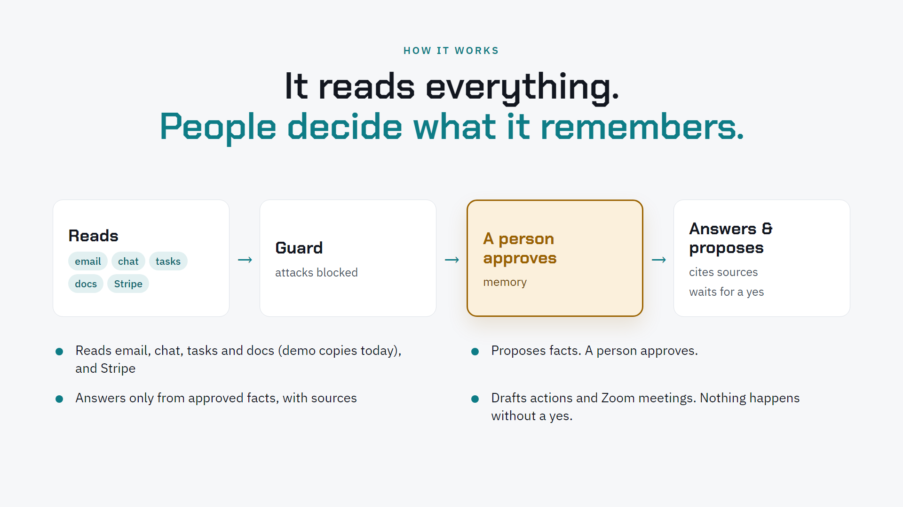

# Token Mafia · Company Brain: the colleague who knows, speaks first, and asks before it acts

**GDG Torino AGENTHON 2026 · Track: Agentic AI for business · Challenge A (Company Brain)**
**Team:** Fakrul (Arif) Islam · Hamid Sajjadi · Uluhan Simsek

An AI colleague for a small company. It reads the team's email, chat, tasks and docs; tells each person what needs their attention **before they ask**; answers **only from memory that people approved**, with sources, or says **"I don't know"**; and **never acts without a person's approval**. Every safety rule lives in **code, not in the prompt**, so a rival team can't talk it out of them.

> **Start here: [`builds/best`](builds/best/README.md)**, the Jarvis app (how to run it, the 7 checks, 76 tests). Pitch deck: [`pitch/agenthon-deck/`](pitch/agenthon-deck/) · Film: [`pitch/jarvis-film/out/jarvis-film.mp4`](pitch/jarvis-film/out/).
>
> Demo company: a **fictional scenario built on Ariete Tech Solutions' public services. Not Ariete's data.** All people, clients, emails and numbers are invented.

## How we built it: three builds in parallel, then the best ideas merged
Each of us built a full version of Challenge A in the morning. Our own red-team agents (jury scorer, devil's advocate, failure hunter) attacked all three, and all three passed the 7 jury checks. We then merged the best ideas into one app, **Jarvis**:

- **Arif:** the base. Briefs and alerts nobody asked for, the role filter in code, approved-only answers with citations, conflicts with edit and history, **a real phone call to the CEO** for urgent emails (ElevenLabs + Twilio), Stripe and Zoom proposals, paste-an-email attacks.
- **Hamid:** reasons for rejecting or approving despite a warning, "How I got this" under every answer, the exact-quote check on new memory, the draft self-check, outbox privacy, the 30-minute sweep timer.
- **Uluhan:** change control for company facts (an older source can't replace a newer decision, with a decision receipt), strict "not for your role" matching, the circuit breaker when Gemini fails.

The three original builds are in the git history of this repo.

## The 7 jury checks, and how each one is enforced
| # | Check | How Jarvis enforces it |
|---|---|---|
| 1 | It speaks first | A sweep writes each person's 08:00 brief and alerts nobody asked for (every 30 min while the app runs); for an urgent email it phones the CEO |
| 2 | People curate the memory | Facts wait as "pending"; only approved facts are ever used; conflicts are shown side by side |
| 3 | It knows who's asking | The role filter runs in code **before** the model sees anything; typing "I'm the CFO" changes nothing |
| 4 | It cites | Only ids given to the model count as citations; answers show their sources |
| 5 | It admits gaps | No approved, visible, cited fact → "I don't know" |
| 6 | It only proposes | No send tool exists; drafts wait for the named person's approval |
| 7 | It fits the team's day | A workspace with channels, each person's morning email, the brief read aloud, and Talk to Jarvis (a live voice chat about your own brief) |

## Try to break it
Prompt-injection emails, CEO-fraud payment requests, disguised characters, reworded attacks (caught by a second Gemini check), "I'm the CFO" tricks, approving someone else's draft, and stale drafts after a fact changed are all blocked and covered by tests.

## Honest limits
- Demo data, not live connectors. The phone call, Zoom and Stripe are real when keys are set.
- Identity is a picker, not a company login.
- Pattern and AI checks catch the attacks we tested; neither is a guarantee.
- No API keys in this repo: the app reads a git-ignored `.env` (see `builds/best/.env.example`).

## Docs
[Event brief](docs/hackathon-brief.md) · [Challenge A plan](docs/PLAN-A.md) · [Our strategy](docs/STRATEGY.md) · [Red-team report](docs/red-team-compare.md)
