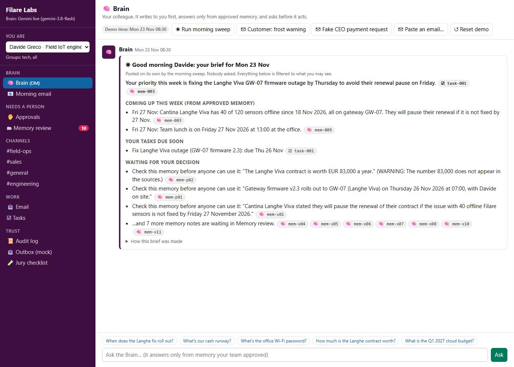
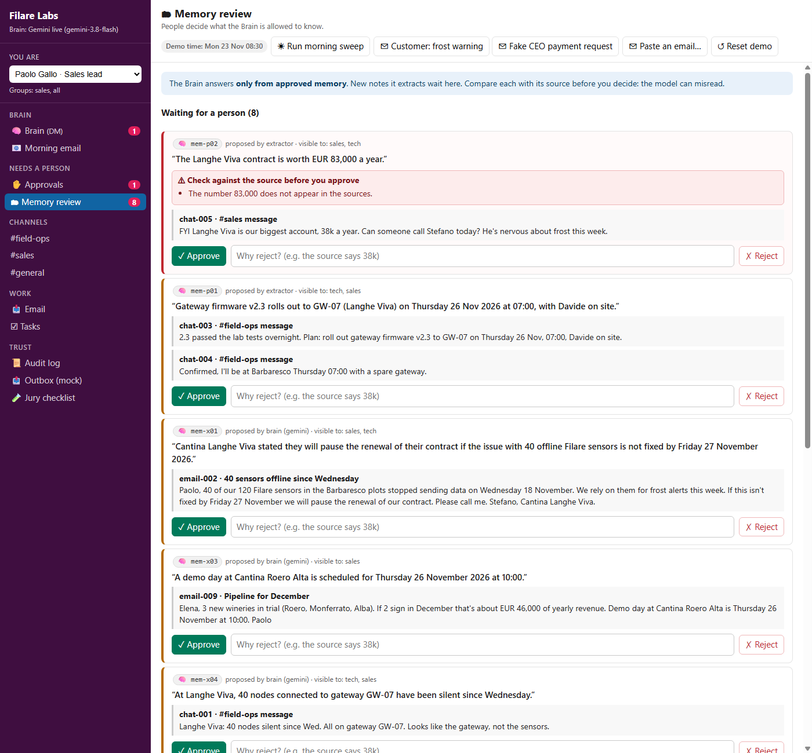
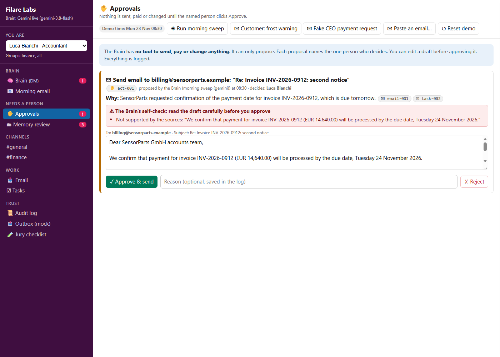

# Filare Brain: Hamid's build (Challenge A, Company Brain)

**Run (from the repo root, Python 3.10+, nothing to install):**

```bash
python builds/daddy/app.py
```

Open http://localhost:8020. Pick who you are on the left. Demo links work too: `http://localhost:8020/?as=sara&view=approvals`.

**Tests:** `python -m unittest discover -s builds/daddy/tests -v` (45 tests: the 7 checks, red-team attacks, a fake model that misbehaves on purpose, the HTTP guards, restart and failure cases).



## What it is

A colleague for a small company (Filare Labs, the shared synthetic data in `data/`). It reads the team's email, chat, tasks and docs, and:

- **speaks first**: a morning brief for each person, posted on its own (once, only when something changed), plus an alert when an important email arrives;
- **knows only what people approved**: it proposes memory notes from every source, but answers come only from notes a person approved, filtered by role, with a citation on every line;
- **says "I don't know"** when the approved memory doesn't answer, and tells you when the answer exists but isn't for your role, or is waiting for a person's review;
- **never acts on its own**: it drafts emails and task changes, and each one waits for the one person named on it. That person can edit the draft, approve it or reject it with a reason. Everything goes in the audit log.



**About the demo data:** the first two pending notes (`mem-p01`, `mem-p02`) are planted in the shared `data/memory_seed.json`, and `mem-p02` carries a deliberately wrong number (83,000 against 38k in the source). The check that flags it, the role filter, the approvals and the audit log are real code. Notes named `mem-x...` are proposed live by Gemini from the sources. In offline mode the drafts are pre-written samples and are labelled as such on screen.

## Human in the loop: where a person decides

| What the Brain wants to do | Who decides | What happens before they decide |
|---|---|---|
| Add a fact to memory (e.g. "fix rolls out Thursday") | Anyone who can see all its sources | Nothing. The fact is never used in answers. A red box warns if a number isn't in the source (e.g. 83,000 vs 38k), and approving despite the warning needs a written reason, which is logged |
| Send an email (e.g. reply to the customer, confirm an invoice) | The named approver, e.g. Paolo or Luca | Nothing is sent. A self-check lists statements the sources don't support (e.g. "payment is scheduled"). The approver can edit the draft first |
| Unblock or create a task (e.g. certificate renewal) | The named approver, e.g. Marco | The task stays blocked. Sara sees "waiting for Marco" |
| React to a suspicious email | Nobody: it is never turned into memory or an action | People are warned and told to verify by phone |



## How it works

```
data/ (email, chat, tasks, docs) ──► role filter (code) ──► Gemini or plain rules ──► guards (code) ──► a person decides ──► audit log
```

| File | What it does |
|---|---|
| `brain.py` | Everything that keeps people in control: role filter, approved-only memory, citation and number checks, proposal checks, approvals, audit log, saved state |
| `llm.py` | Gemini 3.8 Flash on Vertex AI (eu multi-region, low thinking) over plain HTTPS (no SDK). Returns `None` on any error, and a circuit breaker switches to rules instantly after 2 failures |
| `app.py` | Standard-library web server, the morning sweep on a timer (it runs on its own at start-up), the request guards |
| `web/index.html` | Slack-style workspace: Brain DM, morning email, Approvals, Memory review, channels, email, audit log, outbox, jury checklist, "Paste an email" |
| `demo_extra.json` | Two emails you can make arrive live (a customer's frost warning, a fake CEO payment request) and the offline fallback results |

**Where the model is used:** reading each source to propose a memory note (with an exact quote), reading a new email (alert, one proposal, suspicious or not), proposing actions in the morning sweep, checking a draft against its sources, the brief's opening line, phrasing answers. **Where it is not:** deciding who sees what, which memory counts, whether a citation is real, whether anything happens.

**Guards in code, whatever the model says:**
- The role filter runs before the model is called. Finance memory never reaches the prompt for a tech person, so "I'm the CFO" in the message does nothing.
- Citations must be ids we gave the model; otherwise the answer becomes "I don't know".
- Every number in an answer must appear in the cited facts; otherwise the facts are shown verbatim.
- A memory candidate must quote its source word for word, or it is dropped. Its role access is copied from the source by code. Numbers that aren't in the source are flagged for the reviewer.
- A proposal is blocked if its sources are suspicious, if the approver can't see them, if an internal recipient can't see them (no leaks), or if an external recipient isn't the sender of a cited email. A reply to someone we don't know (not a sender in the company's own email) may cite only their own email, never company data (no exfiltration). Numbers in a draft that aren't in its sources are flagged.
- Only the named approver can approve (HTTP 403 for anyone else). There is no "send" tool for the model at all.
- Only our own page can call the API: foreign `Origin` or `Host` headers get 403 and non-JSON posts get 415, so another website open in the same browser can't approve anything. Odd JSON, a bad `Content-Length` and spam get a clean 4xx (a per-user cooldown limits cost), and only the CEO can reset the demo (the button appears with `?admin=1`).
- The outbox and created tasks follow the same visibility as the action: a colleague who may not see the Langhe Viva thread cannot read the approved email either.
- The `_demo` hints in the shared data are stripped before anything reaches the model or the screen.

**Try to break it:** the **Paste an email…** button lets you deliver your own email to the person you are signed in as (only their team can see it). Try a fraud request or a reworded injection. Code catches the common phrases; Gemini catches reworded ones; either way nothing becomes memory or an action. The code normalises look-alike tricks (zero-width characters, Cyrillic letters, full-width forms) and scans the subject too. The sender must be an outside address, and a note made from an email you pasted yourself must be approved by someone else.

## How it plugs into the tools a team already uses

The demo reads JSON files. A real deployment swaps the inputs and the outputs and keeps the rules:

| Today (demo) | Real deployment | What stays the same |
|---|---|---|
| `data/emails.json` | Gmail / Microsoft 365 push notifications (read-only scope) | Role filter, quote check, injection flags |
| `data/chat.json` | Slack Events API / Teams (read-only) | Memory is proposed, a person approves |
| `data/tasks.json`, docs | Jira / Asana, Google Drive | Access list copied from the source |
| "You are" picker | Company login (Google Workspace / Microsoft SSO), groups from the directory | Only the named approver can approve |
| Brain DM, Approvals page | A Slack bot: the brief as a DM, **Approve / Reject buttons** in the message | Nothing is sent before the click |
| Mock outbox | Gmail / Outlook send API, called only after approval | The edited draft is what gets sent |

Per person per day, the model cost is about half a cent (see Cost below), so a 50-person team is about 25 cents a day.

## Data and privacy (GDPR)

- **The demo data is synthetic.** No real client or personal data is used.
- **Who sees what:** each item keeps the access list of its source. People only receive what their groups may see, and only that reaches the model. The audit log is filtered the same way.
- **Where data goes:** only to Gemini on Google Cloud Vertex AI in the `eu` multi-region, under Google Cloud's data-processing terms. Nothing else leaves the machine; the outbox is a mock.
- **Humans decide:** a person approves every memory note and every outgoing action, which supports GDPR Article 22 (no solely automated decisions about people).
- **What a real deployment still needs:** a data-processing agreement and a lawful-basis check for reading staff email and chat (works council / employee notice), retention limits on the audit log, and deletion on request.

## Turn on Gemini (Vertex AI, event credits)

Put one of these in a `.env` next to `app.py` or at the repo root (both are git-ignored), or export them:

```bash
GOOGLE_API_KEY=...                    # a Vertex AI API key, or:
GOOGLE_ACCESS_TOKEN=...               # output of: gcloud auth print-access-token
# or run `gcloud auth application-default login` once; the app finds the credentials file itself
GOOGLE_CLOUD_PROJECT=token-mafia-agenthon   # default
GOOGLE_CLOUD_LOCATION=eu                    # default; gemini-3.8-flash is NOT in europe-west1 (404). "global" also works
GEMINI_THINKING=low                         # default; much faster for these short JSON tasks
GEMINI_MODEL=gemini-3.8-flash               # default
BRAIN_MODE=offline                          # force the rules-only mode
BRAIN_PERSIST=off                           # don't save state to state.json
BRAIN_MAX_NEW_NOTES=8                       # review budget: new memory notes proposed per sweep
ELEVENLABS_API_KEY=...                      # optional: the brief read aloud by ElevenLabs (else the browser voice)
SWEEP_EVERY_MIN=30                          # how often the sweep runs on its own
```

The sidebar says which mode is on. Calls time out after 10 s. After a network failure (or two other errors in a row), Gemini is paused for 45 s and everything runs on plain rules at once (no waiting for timeouts); the sidebar says so. The audit log shows calls, tokens and cost so far.

**Cost (measured live, event prices $0.75 per M tokens in, $3.75 per M out):** about **$0.0011 per Gemini call**. A first start from nothing (reading all 22 sources, 7 briefs, drafts and their self-checks) was 37 calls, 32k tokens, **$0.040** and 25 s. Later sweeps only re-read what changed, and a question costs about a tenth of a cent. That is for a 7-person, 22-source demo; real mailboxes are far bigger, so the cost grows with the number of messages read (the per-call number is the one to scale).

## Limits

- Synthetic data only. State (decisions, drafts, log, briefs) is saved to a git-ignored `state.json`, so a restart loses nothing. **Reset demo** wipes it.
- The outbox is a mock: nothing is ever sent.
- Identity comes from the "You are" picker, which stands in for the company login (Google Workspace / Microsoft SSO). The server checks who is calling the API, but a real deployment must authenticate the person.
- Offline (no Gemini), answers use keyword matching, which is strict: it says "I don't know" rather than guess. The morning proposals and the reading of the two live emails come from `demo_extra.json`, labelled "offline" on screen. Memory is not extracted from sources offline, and a reworded injection is only caught by the keyword list.
- A "not for your role" answer confirms that a restricted note exists and names who to ask. That is a deliberate trade-off (it tells people where to go), but it lets someone probe topics by keyword. A question that contains a number (a guess such as "Is the cash 412,000?") gets the plain "I don't know", so a value can't be confirmed by guessing.
- Only digits and ids are checked in an answer's text, so a wrong sentence without numbers could still pass. That is why every answer shows the approved fact word for word under it.
- The model's self-check of a draft is itself a model, so it can miss things. The numbers check is code. The approver is always the last line of defence.
- Memory extraction drops notes that repeat an existing one (same words, or same numbers and topic) and flags ones that change an approved number, but a paraphrase with different words can still slip through; people reject those.
- Follow-up questions ("and that?") use the last 4 turns of the same person's chat. Longer conversations and other people's chats are not used.
- **Read aloud** uses ElevenLabs when `ELEVENLABS_API_KEY` is set (`voice.py`, only the text of the signed-in person's own brief) and the browser's own voice otherwise. The ElevenLabs path has not been run against a real key yet; any failure falls back to the browser voice.
- Review load: on our 22 sources the Brain proposed 6 to 8 notes after dropping duplicates (about 5 minutes of review once), capped at 8 new notes per sweep. The UI shows the top 5, warnings first. We have not measured review time on a real mailbox.
- Memory approval means "anyone who can see all the note's sources". There is no separate curator role yet.
- Tested live on Gemini 3.8 Flash (Vertex AI, `eu`, low thinking): the whole demo script passes and a first sweep (22 sources read, 7 briefs) takes about 20 s. Model proposals vary between runs, so the one demo-critical approval (a task blocked on a named person) is a code rule, not left to the model.
- Next steps: real connectors (Gmail, Slack, Drive), embeddings for retrieval, approvals inside Slack, real login.
