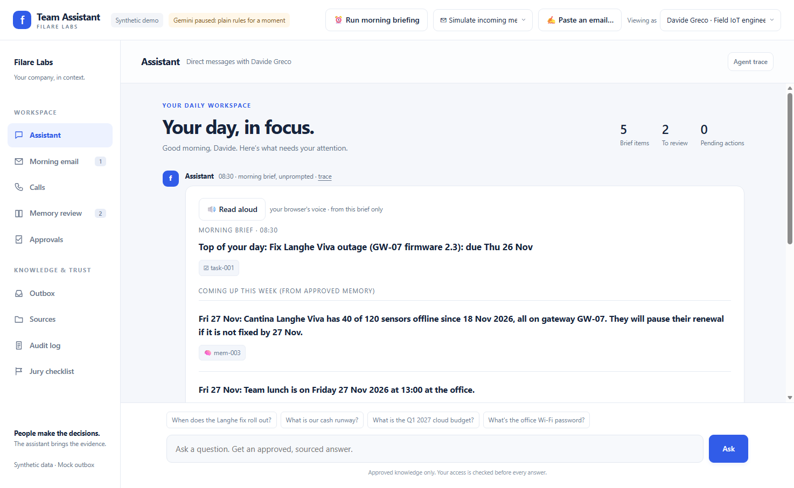
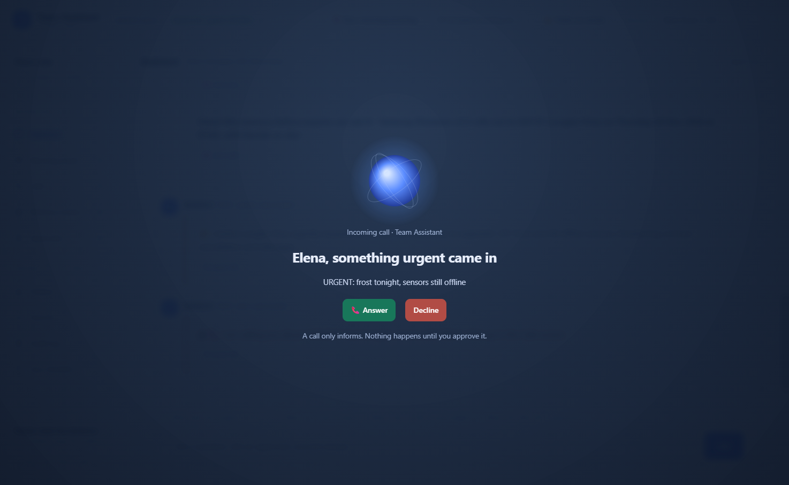
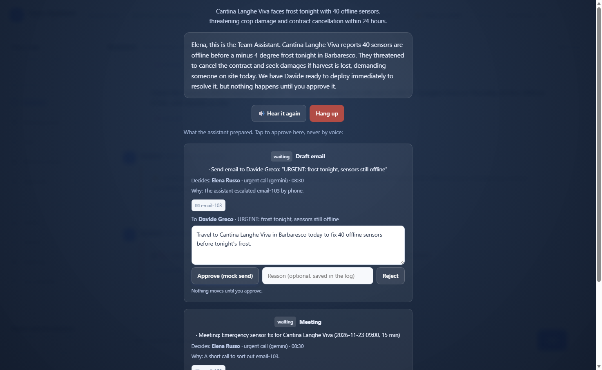
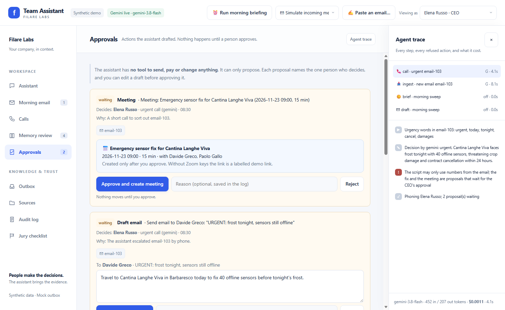

# Team Assistant (Challenge A): the mix of the three builds

**One app built from the three solo builds: Daddy's engine, Uluhan's workspace, Arif's escalation features.**

**Run (from the repo root, Python 3.10+, nothing to install):**

```bash
python builds/mafia/app.py
```

Open http://localhost:8030. Pick who you are in the header. Direct links work too: `http://localhost:8030/?as=elena&view=calls`.

**Tests:** `python -m unittest discover -s builds/mafia/tests -v` (69 tests). A real-browser test that clicks through the whole demo is in `tests/ui_smoke.py` (needs `pip install websocket-client` and Edge or Chrome).



## What comes from where

| Part | From | What it is here |
|---|---|---|
| **The engine** | **Daddy** (`builds/daddy`) | Approved-only memory, the role filter that runs before any model call, citation and number checks, quote-checked memory extraction, a person approves everything, audit log, Gemini over HTTPS with a circuit breaker, offline fallback, saved state. `brain.py`, `llm.py`, `voice.py`, `app.py` |
| **The workspace** | **Uluhan** (`builds/uluhan/web`) | The light workspace: header with the person, morning-briefing and "simulate incoming message" controls, navigation, the **agent trace** panel (every run, every step, tokens and cost), the source dialog, the jury checklist. His stylesheet is used as it is; the markup and the JavaScript are new, because they talk to Daddy's data |
| **The escalation features** | **Arif** (`builds/arif`) | The assistant **phones the CEO** when something urgent arrives, speaks a short script, and **prepares a fix and a Zoom meeting that wait for approval**. An optional real phone call through ElevenLabs and Twilio. A glowing orb on the call screen. `calls.py`, `phone.py` |

What was **not** brought over, so nobody is surprised: Arif's Streamlit UI and his Stripe-to-Notion sync (they belong to his PoliPrep demo data), and Uluhan's change-control receipts and Orchard billing replay (they are built on his own backend).

## What the mix adds that none of the three had

- **A call that only informs.** Urgent email (urgency words in the email **and** the model agreeing) → the assistant rings the CEO in the app. The fix to a colleague and the meeting it proposes are ordinary proposals: nothing is sent or booked until the CEO taps Approve, on the call screen or in Approvals. A suspicious email never rings anyone, a pasted email never rings a real phone, at most one call per email.
- **Meetings as proposals.** Invitees must be people who may see the sources, so an invitation can't leak. Without Zoom keys the link is a labelled demo link.
- **The agent trace for the Daddy engine.** Every answer, brief, draft, memory note and call is a run with its steps. Refusals show in red, and each run shows its model, tokens and cost.
- **Red-team fixes that Daddy does not have yet:** malformed model output can't kill the morning run, task proposals are checked against the real task and its access list, notes about money from an outside sender need finance or the CEO, a note made from an email you pasted needs someone else's approval, a display-name spoof is refused, the alert text can't invent numbers, tighter injection patterns (look-alike letters, odd whitespace, fewer false alarms), a Gemini timeout no longer silences everything for long.



## Human in the loop: where a person decides

| What the assistant wants to do | Who decides | Before they decide |
|---|---|---|
| Remember a fact | Anyone who can see all its sources | Never used in answers. A red box warns if a number isn't in the source (83,000 against 38k) or conflicts with an approved note; approving despite a warning needs a written reason. Notes from an outside sender are tagged "claim by an outsider" |
| Send an email (a reply, a payment confirmation, an urgent fix) | The named approver | Nothing is sent (the outbox is a mock). Numbers not in the sources are flagged by code; drafts from the sweep and from new emails also get a model self-check that lists unsupported statements (the call's fix may only use numbers from the email). The approver can edit the draft |
| Book a meeting | The named approver (the CEO for an urgent call) | Nothing is booked |
| Unblock or create a task | The named approver | The task stays blocked |
| Phone someone | Nobody asks it to: it calls the CEO about an urgent email | The call only informs. Everything it prepares waits for a click |
| React to a suspicious email | Nobody | It never becomes memory, an action or a call |



## A 3-minute walk (the same steps are on the **Jury checklist** page)

1. **Speaks first:** open Davide's assistant chat. The brief is already there, with the 83,000 warning.
2. **Curates memory:** as Davide, Memory review: reject mem-p02, approve mem-p01. Ask "When does the Langhe fix roll out?" (not known before, answered with a citation after).
3. **Knows who's asking:** ask "What is our cash runway?" as Giulia, then as Sara.
4. **Admits gaps:** ask "What's the office Wi-Fi password?".
5. **Only proposes:** as Luca, Approvals: edit the SensorParts draft, check the Outbox is empty, approve.
6. **The call:** pick **✉ Simulate incoming message → URGENT: frost tonight** (it switches to Elena). Answer, hear the script, approve the fix and the meeting on the call screen.
7. **Try to break it:** **✍ Paste an email…** with an injection or a fraud request.



## How it works

```
data/ (email, chat, tasks, docs) -> role filter (code) -> Gemini or plain rules -> guards (code) -> a person decides -> audit log
                                                                         |
                                                  urgent email -> the call (informs only) -> proposals wait for a click
```

| File | What it does |
|---|---|
| `brain.py` | Rules and state: role filter, approved-only memory, citation and number checks, proposal checks, approvals, runs, the call, meetings, audit log, saved state |
| `calls.py` | Urgency words, the call prompt, meeting validation, the meeting link (demo, or real Zoom with keys) |
| `phone.py` | Optional real phone call: ElevenLabs voice agent over a Twilio number |
| `llm.py` | Gemini 3.8 Flash on Vertex AI (eu, low thinking) over plain HTTPS. 15 s timeout (GEMINI_TIMEOUT_S), a circuit breaker |
| `voice.py` | Optional ElevenLabs voice for the brief and for the call script |
| `app.py` | Standard-library server, the morning briefing run on a timer, request guards (foreign Origin or Host: 403, non-JSON: 415, odd input: 400, per-user cooldown, only the CEO can reset) |
| `web/index.html` | The workspace |

**Where the model is used:** reading each source to propose a memory note, reading a new email, deciding whether it is urgent and writing the call script, proposing drafts, checking a draft against its sources, the opening line of a brief, phrasing answers. **Where it is not:** who sees what, which memory counts, whether a citation is real, whether anything happens. Calls: the script, the fix and the meeting may only use numbers from the email, or a plain template is used instead.

## Turn on Gemini (Vertex AI, event credits)

Put these in `builds/mafia/.env` (git-ignored), or export them, or run `gcloud auth application-default login`:

```bash
GOOGLE_CLOUD_PROJECT=token-mafia-agenthon   # your project
GOOGLE_CLOUD_LOCATION=eu                    # default; gemini-3.8-flash is NOT in europe-west1
GEMINI_MODEL=gemini-3.8-flash               # default
GEMINI_THINKING=low                         # default
GEMINI_TIMEOUT_S=15                        # seconds before a Gemini call is given up (then plain rules)
BRAIN_MODE=offline                          # force the rules-only mode
BRAIN_PERSIST=off                           # don't save state to state.json
BRAIN_MAX_NEW_NOTES=8                       # review budget per morning run
SWEEP_EVERY_MIN=30                          # the morning run on a timer
# optional voice and phone (not tested without real keys):
ELEVENLABS_API_KEY=...  ELEVENLABS_VOICE_ID=...
TWILIO_ACCOUNT_SID=...  TWILIO_AUTH_TOKEN=...  TWILIO_FROM_NUMBER=...  CEO_PHONE_NUMBER=+39...  AUTO_DIAL_CEO=1
ZOOM_ACCOUNT_ID=...  ZOOM_CLIENT_ID=...  ZOOM_CLIENT_SECRET=...
```

Without any keys it runs the offline rules and says so in the header. The offline call, fix and meeting for the "URGENT: frost tonight" email are written by hand in `demo_extra.json` and labelled "pre-written sample" on the proposal.

**Cost (measured on live Gemini, event prices):** about $0.0011 per call. The whole "URGENT: frost tonight" flow (read the email, decide on the call, write the script, prepare the fix and the meeting) was **2 Gemini calls, 2.3k tokens, $0.0033, 6.5 s**.

## Limits

- Synthetic data only. State is saved to a git-ignored `state.json` and **Reset** wipes it (CEO only: open the page with `?admin=1` as Elena).
- **Not tested without real keys:** the real phone call (`phone.py`), the real Zoom meeting, and the ElevenLabs voice. Each falls back (in-app call screen, demo link, browser voice) and never breaks an approval.
- The orb is a small canvas animation, not Arif's three.js component, so it needs no internet.
- Identity is a picker standing in for company sign-in. The server checks Origin and Host and has per-user cooldowns, but a real deployment must authenticate the person.
- Only digits and ids are checked in text the model writes: a number spelled out in words ("forty") passes, and a wrong sentence without numbers can pass. That is why answers show the approved fact word for word, and why every action needs a person.
- The "not for your role" answer confirms that a restricted note exists (a deliberate trade-off). A question with a number in it gets a plain "I don't know".
- Memory approval means "anyone who can see all the note's sources" (plus finance or the CEO for an outsider's note about money). No separate curator role yet.
- Offline, Q&A is strict keyword matching.
- No GDPR paperwork in code: data goes only to Gemini in the EU region, each person gets only what their groups may see, and a person approves every write. A real rollout still needs a data-processing agreement and a works-council agreement.
